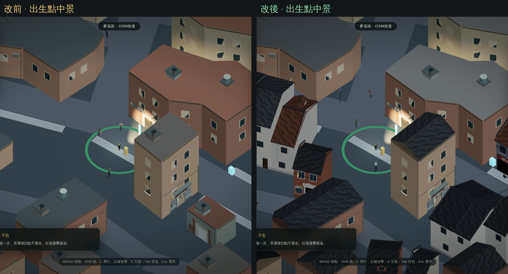
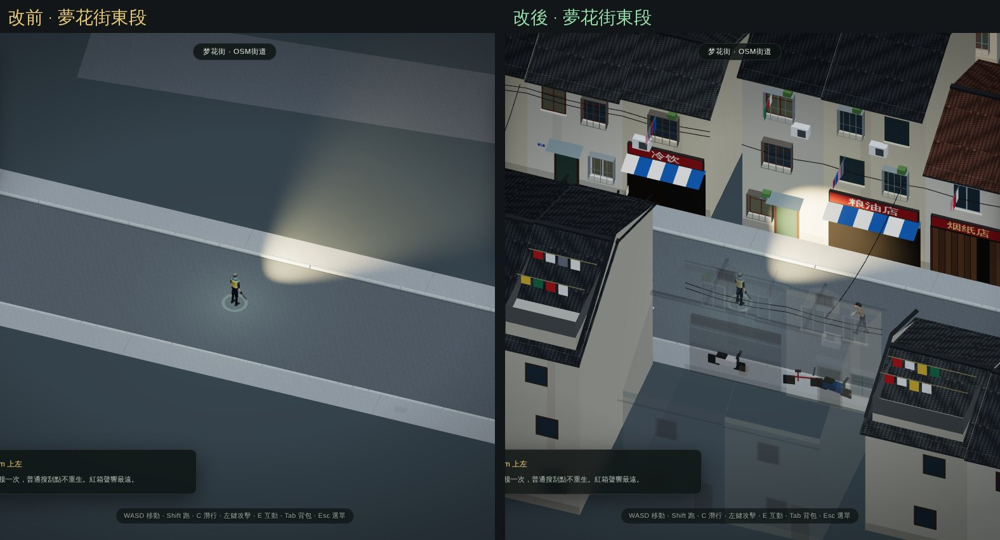
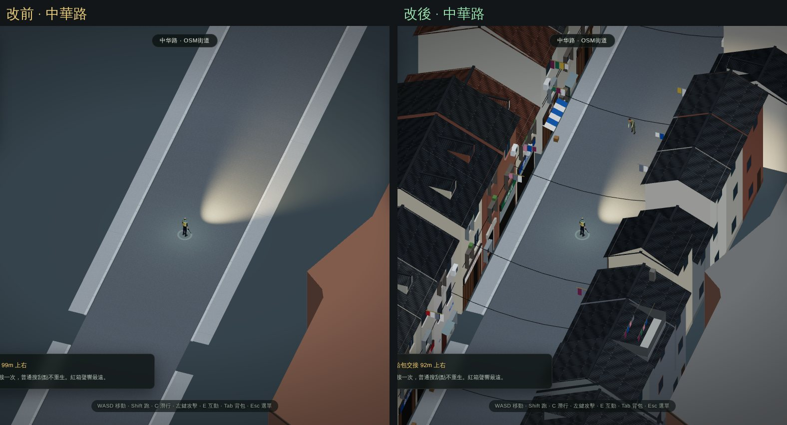
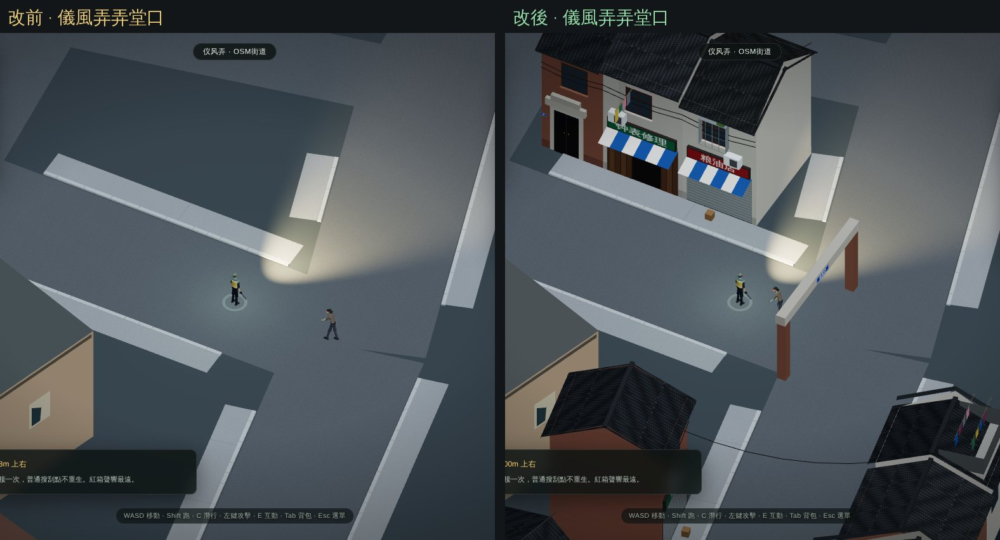

# 老西門弄堂街區：把夢花街一帶補回成老城廂

目標：讓上海人一看就認得是上海。重點不在逐棟還原，而在街區的樣子。

## 為什麼要補

CMAB 是 2020 年底的屋頂輪廓。夢花街一帶有很密的真實弄堂路網，但路與路之間在資料裡幾乎是空地：夢花街全長 250 公尺，兩側 12 公尺內只有 7 棟建築。玩家一出門看到的是空曠的柏油地，不像上海。我們推測，這些空地反映的是舊改拆遷前後的資料狀態。

## 做了什麼

### 沿真實弄堂補回成排的老房子

`src/lane-fabric.ts` 負責規劃：
- **範圍**：出生點 320 公尺內，沿每條 OpenStreetMap 道路的兩側，在空地上一間間排出臨街的兩三層老房子。
- **規模**：共 607 排、約 1,500 間。每間面寬 3.0 到 4.5 公尺，進深 5 到 9.5 公尺，每 3 到 8 間留一條 1.4 公尺的窄縫通往後面。
- **不壓到**：
  - 道路和人行道
  - 既有的 CMAB 建築（至少隔 1.1 公尺，形成後弄）
  - 安全屋門口、9 間室內房間入口、出生點綠圈、行道樹和路燈
  - 文廟院內（55 公尺）、學校（28 公尺）
- **依道路分類**：主幹道多為三層、七成五是店面；一般街道兩三層、一半是店面；窄弄堂以兩層住家為主。
- **街道是真的，房子是重建的**：結果完全由道路和空地決定，可重現，不代表某間房子真的曾經在那個位置。

### 老城廂的房子

`src/lane-houses.ts` 負責外觀：
- **屋頂**：
  - 小青瓦斜屋頂，用程式畫的瓦片紋理，屋脊與街道平行，帶屋脊壓頂和簷口
  - 排頭是山牆，其中約一半是高出屋面、帶深色壓頂的封火牆
  - 相鄰兩間高度不同時會補上錯落的牆
  - 老虎窗、曬台（附欄杆和晾衣繩）、偶爾一片紅瓦或鏽鐵皮補丁、煙囪
- **牆面**：舊石灰抹灰，或青磚、紅磚；底部有水泥勒腳，簷下有髒污，牆上有水漬。
- **窗**：木窗（深紅、深綠、棕色）或鋁窗，約三到四成加了外凸的防盜窗，籠上放盆栽。冷氣外機、伸出窗外的晾衣竹竿和衣服。
- **一樓**：
  - 店面：排門板（拆下幾塊正在營業）或捲簾門，加簡體字招牌和條紋雨棚，例如「烟纸店」「粮油店」「生煎馒头」「老虎灶」「修鞋配钥匙」「理发店」，都是行業名稱，不是真實商號。
  - 住家：弄堂裡多是石庫門（石框、黑漆雙門、銅門環、門楣），街面上多是木門加小雨棚。
  - 門邊有藍底白字的門牌「12号」：同一條路一側單號、一側雙號。
- **CMAB 建築**：
  - 輪廓接近矩形的（矩形度 85% 以上，進深 4.5 到 14 公尺），直接在原本的精確輪廓上加斜瓦屋頂，屋脊不超過 14 公尺。碰撞不變。
  - 其他維持平頂，顏色改成灰色水泥，看起來像八九十年代的樓房。

### 弄堂生活

`src/lane-life.ts` 負責街景：
- 沿街和跨街的架空電線
- 窄弄堂兩側房子之間架的晾衣竹竿和衣服
- 停在門口的電瓶車和自行車
- 街角藍底白字的路名牌，用的是真實路名，例如「梦花街」「仪风弄」
- 有「弄」字的弄堂口立磚柱和石門楣，兩面都掛弄名

路牌、招牌、門牌都用簡體字，因為上海街上用的是簡體字。

## 存檔相容

- **新遊戲**：存檔記為 `worldLayout: 'laoximen-lanes-v1'`，會看到補回的弄堂和 9 間室內房間。
- **舊存檔**：`menghua-infill-v1` 的存檔維持原本的 4 棟補建小屋，沒有版本號的舊存檔維持原版，都不會看到補建的房子，也不會被移動位置。
- 補建房子的碰撞和建築內外判斷只在新版面啟用，敵人和物資的生成也會避開它們。

## 驗證

以下都在 Node 環境驗證，不是瀏覽器驗收。

- `tools/test-lane-fabric.mjs`：
  - 結果可重現、不壓路和人行道、不碰既有建築，不同排之間至少隔 1.2 公尺
  - 文廟、學校、安全屋門口、出生點都留空
  - 可通行性和補建前一樣：出生點 300 公尺內，515 個道路點裡 496 個走得到，其餘 19 個是 OpenStreetMap 道路本來就穿過 CMAB 屋頂的地方
  - 存檔接受新的版本號
- `tools/test-lane-houses.mjs`：
  - 在沒有瀏覽器的環境也能生成
  - 約 27.6 萬個三角形，只用 4 個網格
  - 招牌只用簡體字，所有招牌和門牌都找得到對應的字
  - 擋住玩家的那排會淡出
  - 街景數量有上限
- 既有測試同步更新：城市建築從 3 個網格改成 4 個（多一個瓦屋頂），新版面要開 9 間房間，碰撞要包含補建房子。安全屋室內視角的遮擋測試改用平頂驗證切換機制，並另外檢查斜屋頂版本。

改前改後的畫面：

## 效能與待實機確認

- 同一出生點、預設縮放、開局 2.5 秒時（軟體算圖 Chromium，敵人位置每次不同）：
  - 繪製次數 214 變 188，補建房子是合併網格，所以沒有增加
  - 三角形 35.8 萬變 62.5 萬
- 載入時規劃約 0.3 到 0.4 秒（Node 測得）。
- 手機上的幀率和載入時間還要實機確認。如果太重，可以縮小補建範圍，或減少防盜窗、衣服這類細節。
