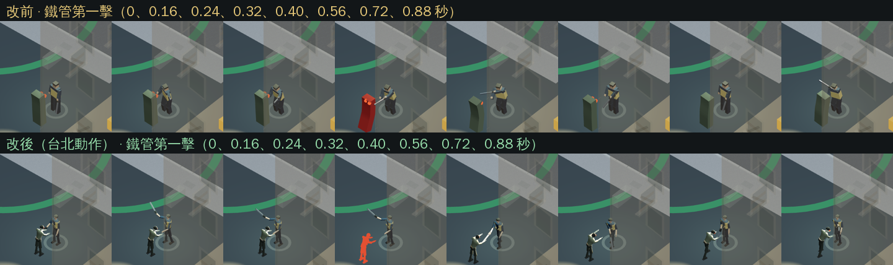
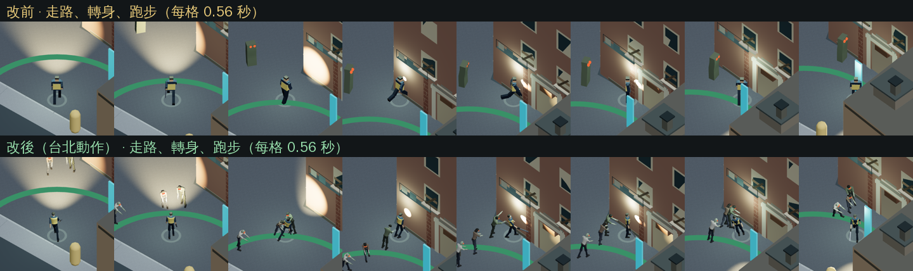
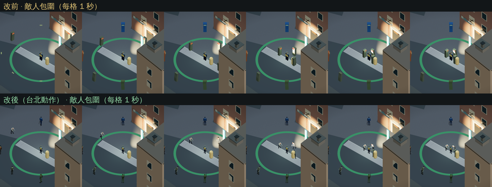

# 人物動作移植自《保衛台北》

目的：解決走路和打擊動作僵硬。人物骨架與動畫直接採用 DefendTaipei-Lab 的 `src/npc/human.ts`、`src/map/fabric.ts`（同一擁有者的專案，經擁有者同意複製），上海這邊只補需要的部分。

## 改了什麼

- **人物**：12 位倖存者改用台北的白面人骨架（骨盆、腰、胸、頸、頭、上臂、前臂、手、大腿、小腿、腳）。保留上海各自的膚色、衣服、髮色和職業特徵：圍裙、背心、安全帽、背包、帽子、白袍；身高照原設定縮放。
- **走路**：台北的步伐鎖定步態：腳往前踩多遠，步伐就前進多少，支撐腳貼地；骨盆高度由髖部校正，轉彎內傾、加速前傾、呼吸和待機重心轉移。
- **移動慣性**：加速、減速和轉身速度照台北參數（加速 9、減速 7、轉身 10）。滑鼠與觸控瞄準仍是即時的，命中判定不受影響；身體轉向較快地跟上。
- **打擊**：
  - 動作分四段：蓄力、加速出手、收招時甩過頭一點、慢慢回位，髖帶腰、腰帶肩，並往前踏步。
  - 正手、反手都重新調過，刀尖掃過的方向對準傷害扇形；左手揮擊用鏡像。
  - 徒手有直拳和勾拳；丟磚有投擲動作；推開沿用台北的推人姿勢。
  - 命中停頓由 35 ms 改為台北的 70 ms，攻擊者和被打的人都會短暫定格。
- **揮擊方向**：舊人物把「右手」放在角色的解剖學左側。新骨架的左右是正確的，所以 `melee-motion.ts` 的傷害扇形一起鏡像：右手第一刀從右側掃到左側（正手）。扇形大小、時序和傷害不變。
- **敵人**：
  - 由三根骨頭的方塊改成同一套骨架，每種陣營外觀建一個模板，其他敵人複製模板、共用模型資料。
  - 感染者會拖腳、前傾、低頭，追擊時伸手；軍方追擊時舉槍，射擊有後座；警員持警棍，掠奪者持鐵管。
  - 轉身有速度上限。被打會往後縮，打中玩家時有攻擊動作，死亡會倒地約 2.4 秒後才消失。
  - 距離玩家 60 m 外的敵人隱藏且不跑動畫；眼睛發光改為跟著頭部移動。
  - 敵人用精簡版骨架：每個關節合併為一個網格、不含手指和褶皺細節，以減少繪製次數。玩家角色維持完整品質。
- **玩家**：受傷時往後縮，死亡時倒下，跳躍時收腿。

## 驗證

- `node tools/test-human-motion.mjs`：
  - 用實際的 `poseSurvivor` 和 `mountHandItem`，檢查三種工具、兩隻手、兩個方向的刀尖方位。接觸和收招時，刀尖與傷害扇形的差距都在 0.2 弧度內。
  - 另外檢查鏡像、命中定格、敵人複製、感染者姿態、跳躍和死亡姿勢。
- `node tools/test-characters.mjs`：12 位角色站立時腳貼地、身高誤差在 2% 內；走路和跑步時支撐腳離地介於 −3 cm 與 +5 cm 之間。
- 既有的近戰、推開、射擊、敵人行為和存檔測試改用新骨架後全部通過。遊戲判定斷言不變；只有以下兩項依新規格更新：命中停頓改為 70 ms，敵人倒地時間改為 2.4 秒。
- 在軟體算圖的 Chromium 中逐幀錄了改前和改後的走路、轉身、連擊和敵人靠近畫面，供對照。這不能代替真機手感驗收。

## 繪製負擔

同一出生點、預設縮放、軟體算圖 Chromium 的 `renderer.info` 數字：

| 情境 | 改前繪製次數 | 改後繪製次數 | 改前三角形 | 改後三角形 |
|---|---:|---:|---:|---:|
| 剛開始 | 89 | 179 | 34.2 萬 | 35.0 萬 |
| 12 個敵人包圍 | 109 | 344 | 34.2 萬 | 38.7 萬 |

敵人沒改用精簡版之前，包圍時是 483 次。

## 還要實機確認

- 手機上的幀率：繪製次數約為改前的 2 到 3 倍，近距離有十幾個敵人時，請在手機上試玩。
- 各武器實際握持的角度。
- 左手持槍和雙持的站姿。

## 改前與改後

同一段腳本、同一角色（老周）逐幀錄製（軟體算圖，畫面時間固定每幀 1/25 秒）。

